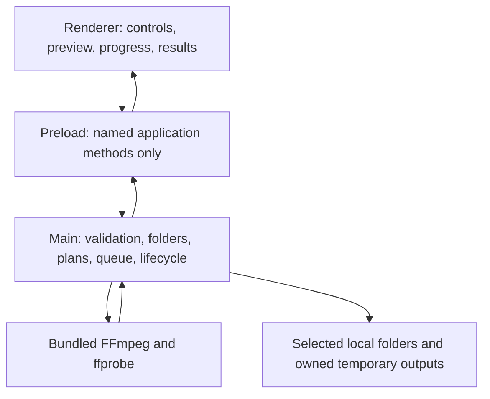

## Original icon and persistent appearance — October 23

Main now owns a separate `AppearanceSettings` instance and the fixed `dark`/`light` choice. It loads before window construction and selects `nativeTheme` plus the initial background; the renderer receives inert snapshots through named, trusted-frame preload/IPC methods. Immediate saves are limited to eight active/queued writes, and synchronous admission closure precedes shutdown drainage. This store never reads or changes processing defaults, profile recipes, drafts, grants or media paths.

Semantic CSS pairs cover the six workspaces and their control/status/focus surfaces, with a first-paint media-query fallback. Button text and fill switch together; only borders retain the short decorative transition. The original licensed Folded Frame header geometry is inline and static, preserving the exact three-asset application protocol. Candidate window/package icon paths and the five-file artwork allowlist are explicit; accepted 0.6 packaging policy is unchanged. Direct/store/ASAR/offline PE checks remain distinct from bounded no-media display-host native/persistence observations and remaining production/portable acceptance. The [appearance receipt](Execution%20Summaries/2026-10-23_Icon_and_Persistent_Themes.md) owns current evidence and limits; dated architecture/media checkpoints below remain historical.

> **Native evidence update — October23.** The [native workflow receipt](Execution%20Summaries/2026-10-23_Native_Workflow_Acceptance.md) now demonstrates the existing production main/preload/renderer journey for bounded CPU SDR Encode and Full MP4 Remux, including native dialogs, receipt-bound Open, both busy-close choices and restart. No architecture or application source changed. The following content-derived HDR architecture remains applicable; its dated review stop is historical. Full native/portable/all 43 acceptance remains open; current authority and next action belong to [Continuation](10_Continuation_State.md).

> **Reviewed content-derived CPU HDR checkpoint — October 23.** Source 38392493973422eaf2c075a9af6e1e1656f7594c passed independent fitting, first unoverridden default H1/H2b holdout and nine actual refusal reviews. The enabled default catalog admits the finite content-derived classes while preserving per-input full SHA/current identity/runtime and complete independent final checks. Final documentation/private-branch/live readback belongs to the [receipt](Execution%20Summaries/2026-10-23_CPU_HDR_Content_Eligibility.md). Stop for Blue before broader work. Version0.7.0-alpha.1 remains unaccepted; N verified/O–R partial/S pending, all 43 retained. Accepted/default/ArchiveCQ29/private records/benchmark visual gate remain protected.

## Content-derived CPU HDR ownership and qualification — October 23

Main owns the distinction between qualification and input eligibility. The catalog qualifies the reviewed implementation/runtime/settings and exact native configuration classes; it contains no list of allowed source-file hashes. Each input independently establishes membership from complete compressed and decoded content before Ready, while its full SHA256 and current filesystem identity bind the actual bytes to that preparation and every later check. The finite route is CPU HEVC `slow`/CRF 25, Full/source geometry/Matroska/preserve, one video and no audio/ancillary streams. The five source classes and conjunctive bounds are in the [Technical Reference](03_Technical_Reference.md#content-derived-cpu-hdr-contract-and-limits--october-23); arbitrary geometry/rate/producer combinations are not admitted.

`hdr-workspace.cjs` performs the existing main-owned folder/draft handoff. `hdr-input.cjs` retains a source handle, checks full SHA/identity before and after observation, and owns exactly two sequential fixed ffprobe children: complete stream/extradata/packet capture, then complete decoded frames. Genuine private WeakMap receipts bind path, source identity/probe, runtime and reviewed profiles. Clones, cache entries and serialized descriptions cannot supply authority. Compressed picture counts and predicted pixel work are checked before decode; actual decoded EOF independently agrees. Actual close, both pipe EOF events, complete capture accounting and cancellation through close are required.

`hevc-content.cjs` is a pure classifier of every captured configuration array and packet NAL, including all compressed SEI. It matches complete reviewed canonical VPS/SPS/PPS plus hvcC bytes, with no masked fields. Constant mastering/CLL values and true presence/absence remain source-derived; unknown functional payloads, changed/unsupported configurations and incompletely consumed descriptions refuse. The HLG alternative-transfer signal must agree with SPS. Explicit CLL 0/0 refuses before Ready because the pinned writer's zero request emitted no CLL payload; absence is a separate state. Pure classification grants neither execution nor publication.

`hdr-container.cjs` separately observes named raw Matroska timing and track-enabled scalars from the same complete sealed bytes. It checks explicit TimestampScale/DefaultDuration, declared header duration, neutral track scale/delay/offset and enabled-track state, preserving explicit/default origins. Ordinary average-FPS or disposition summaries cannot substitute for these raw facts. This bounded reader skips known-length uninspected fields and makes no generic Matroska preservation claim; the complete main probe/content/preservation policies retain their separate obligations.

`HdrOperations` builds the immutable plan only from genuine complete input observations and the current qualified route. Its content-only `setts` contribution binds the unique final presentation PTS and separately frozen source header: it preserves native-rescaled PTS/DTS and adjusts only that packet's serialized duration to the exact reviewed low/high state. This retains the declared source header while the complete demuxed frame vector remains independently exact. No output-header patch, decoded-frame adjustment or source/output timing tolerance is introduced. Main freezes this contribution with the plan/runtime/UUID and canonical invocation; the renderer receives inert status/argv descriptions, never expression or profile authority.

`hdr-evidence.cjs` owns complete source reobservation, staged-container observations, independently extracted HEVC, full seals and output/elementary pixel consistency. Per-frame signal/static checks use bounded internal sampled chunks; only genuine complete acquisition and its contiguous aggregate establish full coverage. Source reobservation must retain the original full SHA, compressed fingerprint, native timeline, configuration and raw container facts. The independently validated staged output must retain every native PTS/duration, exact declared header and named raw scalars. Telemetry independently checks encoder-input count/order. Pixel extraction consistency does not establish lossy source/output equality or display quality.

Complete validation is still separate from completed-source assessment, current runtime/storage/selection checks and protected no-overwrite publication. Reprepare, cancellation, replacement, service recreation and closure revoke current plan/selection authority; a ctime-only completed-source warning renews none. A successful fitting run is not first-run holdout or default-factory proof. The default catalog checks pinned configuration and producer-manifest bytes when loading; the 56-file producer manifest covers acquisition/classification/owner, main/preload, runtime/storage/telemetry, source/preservation/publication and related dependencies. A covered byte mismatch yields no catalog policy. These seals bind the reviewed producer and do not replace current per-input/runtime/lifecycle checks.

Reviewed fitting e2585ab6 passed four generated cases and lifecycle negatives (134 calls). First unoverridden default fcde4d43 passed independently specified H1/H2b (86), with independent review of all 6567 frame observations/20 artifacts/live hashes/telemetry and diagnostic/publication/recreation order. Original H2 generation was overbyte and remains retained; fresh low-motion H2b passed the unchanged legacy template. Default negative60a78182 passed nine specific before-Ready refusals with no fixture encoding/Ready/publication/outputs (69 calls including generated/null capability work). Independent reconstruction of all eight same-length fixtures, separate CRC/VCL checking and diagnostic/stderr/refusal review passed. Every campaign closed maximum 1/live 0 with released leases and empty closure failures.

Reviewed source 38392493973422eaf2c075a9af6e1e1656f7594c is committed; final documentation/private-branch/live readback is parent-owned in the active receipt. Raw producer pins qualify local working-tree bytes, not automatic Git-normalized/autocrlf cold-clone/package/portable equivalence. Device-observation/AMF/QSV hardware limits below are unchanged. No tone-map/Dolby/audio-ancillary HDR, native UI/portable/HDR-display or whole-requirement acceptance follows. Stop for Blue at this reviewed finite checkpoint before broader work.

## Historical two-seed CPU HDR/device-observation checkpoint — October 23

The following block preserves the earlier source checkpoint and its dated support/evidence. Its seed-only catalog and review-stop statements describe that historical state; the current content-derived continuation above owns present scope.

> **Historical checkpoint — CPU HDR preservation and device observations, October23.** Reviewed code `c3168053182e7df6e82fc945935aa3e5f3792faa` completes only the two-seed CPU PQ/HLG normal-service family and main-private observation plumbing (Plan31 Slice4a). Final regression:1328 passed,0failed,1Windows fixture skipped. STOP here for Blue review before broader work; no automatic successor. [Evidence receipt](Execution%20Summaries/2026-10-23_0.7_Slice4a_CPU_HDR_and_Observation.md) and [Continuation](10_Continuation_State.md) own exact support, final checkpoint readback, remaining work and limits. All43 requirements and protected accepted/default/benchmark state remain; Security Cloud is excluded.

### CPU HDR preservation and device-observation ownership — historical October23 checkpoint

`hdr-workspace.cjs` adapts the existing folder/draft preparation to `HdrOperations`; it does not change ordinary SDR classification. The separate owner binds an immutable plan and private current selection to the exact reviewed source SHA256, sparse/filesystem identity, probe, CPU settings, paired runtime, budget and epoch. Reprepare, cancellation and closure revoke the selection. Main's `createOperationControls` supplies the runtime observer, lazy cumulative evidence store and canonical telemetry; renderer receives only existing inert status/argv descriptions. `hdr-catalog.cjs` enables only two reviewed generated seed-byte cells after independent laboratory review and fresh unoverridden default-factory confirmation. This does not qualify a different source with matching headers.

The service retains its existing sequential child/stage lifecycle. `hdr-evidence.cjs` owns bounded acquisition of complete source/container frames, independently extracted HEVC, native output/elementary pixel hashes, exact presentation clocks and full source/output seals. Only its genuine completed receipt reaches the independent HDR operation validator and encoder-input telemetry check. That validation does not itself authorize publication: completed-source assessment, current runtime/storage/selection checks and the existing no-overwrite publisher remain separate final owners. A ctime-only completed-source warning renews no preparation/catalog authority. Lossy source/output pixel equality and HDR-display acceptance are not claimed.

Main now retains one `NativeCapabilityRegistry` across backend discovery calls. Raw closed-child observation receipts bind QSV's explicit derived D3D11 ordinal/descriptor and queried MFX API version to complete before/after DXGI inventory and exact executable/invocation evidence. Effective mode/quality/preset must come from that encoder child's complete scoped log. This remains bounded assurance: no atomic encoder LUID query, final-session identity or loaded-vendor-DLL identity is established. AMF's pinned CLI has no complete same-component effective-property producer and refuses its probe before children start. The explicit bounded main-only QSV initializer owns a fixed zero-frame generated/null child and returns one-use API evidence; original device/current post-discovery identity and cancellation through slot release are required. Its software/source/injected evidence is reviewed, with no initializer IPC, startup activation or actual AMD/Intel qualification. The [evidence receipt](Execution%20Summaries/2026-10-23_0.7_Slice4a_CPU_HDR_and_Observation.md) owns final results and the Blue review stop (Plan31 Slice4a).

## Slice3 main-private Remux ownership — October23

Remux shares the actual folder workspace, sequential queue, diagnostics, source checks, staging, cumulative evidence storage and protected publisher. `remux-workspace.cjs` prepares Full copy plans and issues exact non-primary stream candidates/grants bound to current source/stream/plan/draft/revision/target. Reprepare/target change/cancel/restart revoke authority; renderer receives inert descriptions/current IDs and canonical argv, never arbitrary commands or paths. Unchanged Encode behavior remains separate.

`remux-operation.cjs` owns genuine immutable plans/selections, a source-owned route policy with its measured paired-runtime identity, one-use output IDs and complete-evidence admission. `remux-evidence.cjs` independently acquires every mapped native video frame, decoded AAC sample, subtitle coded event/header and attachment payload/header plus exact timing. Only a branded complete receipt can reach canonical validation and publication. Catalog applicability is distinct from per-job validation; current enabled routes and evidence are owned by Current/receipt, not inferred from this architecture.

> **Historical Slice2 checkpoint — October23 continuation2: stopped for parent review before Slice3.** Bounded CPU/NVIDIA SDR range admission is main-wired and has normal-service success/cancel evidence, runtime/storage controls and canonical telemetry/full validation. Version0.7.0-alpha.1 remains unaccepted; N verified, O–R partial, S pending. [Slice2 receipt](Execution%20Summaries/2026-10-23_0.7_Slice2_Qualified_Lifecycle.md). Earlier pauses/plans/checkpoints below retain their dated scope. No automatic successor or benchmark continuation.

## Slice2 main-owned qualified lifecycle — October23

Main verifies the candidate pair, then creates a private runtime observer, fixed evidence-backed family selector, canonical telemetry configuration and lazy cumulative evidence store via createOperationControls. Renderer receives only descriptive controls/argv/state; no catalog, raw command, path, storage or qualification grant. Family applicability is separate from exact per-job genuine builder/input/settings/probe/identity/budget/epoch bindings.

An admitted changed operation follows runtime/storage admission → exact canonical argv with owned typed stats slots → actual closed child → encoder-input count/timeline check → complete decoded source/output and packet-clock evidence → canonical validator → bounded completed-source assessment → protected publisher. Unknown/partial/incomplete evidence refuses publication; a sealed retained output is not a validated result. Ordinary Full stays on its existing compatibility path. Shared source/runtime/storage resources drain before shutdown diagnostics, including independent closure attempts after failed drainage.

The finite short SDR family and exact support/refusal limits are in Current/receipt. Normal service shares main's factory and real inspection/capabilities; native application/portable support is separately unverified. Main wiring is implemented, not merely proposed; twelve representative cells do not qualify other media/settings/hardware.

# Project architecture

## Slice1 presentation architecture — October23

The shared six-workspace shell adds an explicit unavailable Full-only Remux surface while preserving real main-owned folder dialogs and Encode settings. The renderer's focused file is a presentation cursor, independent of selected file IDs and temporary main grants. Existing editor/detail DOM nodes move into one inspector and return to their row; no parallel draft, cloned authority or command builder is added. The same batch/inspector moves to Current Jobs during busy/terminal states with focus handed to visible navigation rather than automatic workspace activation.

At narrow widths the Files drawer hides only the list/filter/authorization toolbar; summary, Start and selected-set review remain in the page flow. Hidden counts include the actual narrow drawer state and update at the breakpoint without API calls. Main/preload/service/protocol/builders/runtime/defaults are unchanged. These are Slice1 presentation changes with isolated fixture evidence, not enabled Remux/transforms/vendor/HDR or milestone R closure. See [receipt](Execution%20Summaries/2026-10-23_0.7_Slice1_Workbench.md); underlying O–S limits below remain.

## Historical October13 architecture snapshot — later Slice2/3 integration is described above

Reconciled October 13 against application checkpoint2994932, later diagnostic checkpointc196cdd and saved reports at HEAD290369b. No implementation or runtime verification occurred in this pass. N contracts are closed; O–R partial and S final qualification pending. [Tracker25](25_0.7_Requirements_and_Evidence.md) distinguishes interfaces from usable product paths.

- Main owns source/folder authority, bounded incident history, atomic versioned App Settings, drafts, prepared plans, queue snapshots, child lifecycle and publication. The renderer has narrow typed views and commands; settings or stored paths never grant process/FS/IPC authority or mutate queued/active jobs.
- The functional workbench has Encode, Jobs, History, Settings and Help. Folder choose/change controls remain; direct file selection is absent. Per-file exact range fields/sliders and effective options are implemented, but displaying a control is not proof its operation can execute. Remux has no complete application workflow.
- Ordinary admitted Full/KeepSource SDR preparation stores the canonical immutable encode-operation plan. Display uses that same argv with only its final temporary-output slot labelled/substituted; the accepted preservation validator remains in use. `encoder-service.cjs` rejects changed ranges/resolution/audio/container, unsupported color/HDR and omission choices before admission (`OPERATION_QUALIFICATION_REQUIRED` for unqualified operation changes). The standalone operation-evidence collector, HDR, Remux and vendor-probe modules are not integrated into this admission/execution path.
- Pure AMF/QSV adapters, per-device registry and main-only discovery/probe orchestration exist. Discovery or injected tests grant no native support. Local inventory has no AMD/Intel encoding device. HDR contracts/writers/validators and narrow CPU/NVIDIA numerical fixtures are distinct from application enablement and HDR-display judgment; tone-map/DV contracts remain descriptive/nonexecutable.
- Range/geometry/audio builders and complete streaming decoded-evidence collection exist. Ten narrow ordinary CPU/NVIDIA range/audio cells pass; SVT AAC duration fails, SVT FLAC remains unrun. Remux native cases expose actual timing/layout losses: builders and receipts do not grant production qualification.
- Post-output validation may retain an otherwise valid completed result with a complete comparable ctime-only warning. Strict preparation/cache/reencode identity remains unchanged. Incomplete checks, meaningful changes, cancellation and collisions remain distinct; uncertain completed stages are retained. Exclusive-copy fallback hashes the stage/destination before cleanup, without mandatory whole-source prehashing. Published output actions use a checked private receipt and ephemeral tokens.
- Candidate runtime startup verifies isolated FFmpeg/ffprobe9.0.2 before service/window/IPC, with Electron44.7 activated independently. Accepted0.6 and root9.0.1 benchmark resources are separate rollback namespaces.

Shared contracts24/26 retain design intent. Qualifying and integrating new routes, truthful progress/warnings/cancellation and candidate packaging are unfinished. [Pause record29](29_0.7_Owner_Pause_and_Documentation_Reconciliation.md) records decisions, evidence limits and conditional continuation. No new architecture decision or safety relaxation was made during reconciliation.

## Accepted 0.6 architecture and historical verification — September 24

The canonical builder preserves exact MP4 stream creation_time as SOURCE_CREATION_TIME on the same mapped Matroska track; validation requires the exact value and refuses conflicting aliases. Inspection derives the visible notice, including on cache hits, and preservation policy2 invalidates prior policy evidence. Other metadata/content checks remain strict. Source identity remains conservative; failures add bounded field/checkpoint/expected/actual diagnostics to local results without new IPC authority.

The current helper is CQ29 under Decision17; six ordinary defaults and saved values are unchanged. The fresh packaged source/resources match checkpoint7b41c0f and pass actual extracted runtime checks. Final disposition is in the September24 M report.

## Amended L architecture — September 20, 2026

The existing main-owned plan/queue remains authoritative. Preferences store local folder strings and per-profile settings, never folder/plan tokens. Main revalidates restored folders and issues fresh identities on each process start. Version1 records remain readable; version2 adds optional strict recipeId and is preserved as unknown by older readers. Missing paths or unavailable profiles/recipes stay visible; no automatic create, inspect, encode or fallback occurs.

Generated files remain excluded by default. Separate explicit actions distinguish ambiguous legacy classification overrides from deliberate generated-output re-encoding. Re-encode authority binds only chosen file IDs, the current plan and complete inspected identity; source revalidation invalidates changed/empty/deleted input. It is not persisted. New results receive normal K provenance/publication protections. The optional bounded FFMPEG_ENCODER_GENERATION description is validated descriptive data, not cleanup authority or authenticated history; absent/contradictory data degrades to unknown without losing generated recognition.

media.cjs now supplies canonical encoderContribution/describeRecipe and the actual prepared production argv. Main exposes narrow read-only recipe/details APIs; renderer cannot submit argv. Preparation freezes arguments with one labelled temporary-output placeholder; execution substitutes only its final staging path and exposes the resulting actual invocation. JSON argument arrays avoid pretending to be a Windows shell command. Three exact global application provenance tags may be replaced on re-encoding; ordinary, stream and chapter metadata remain subject to preservation checks.

Archive Quality is a separate HEVC helper (P7/UHQ/fullres/VBR-CQ29/bf4/B-ref each), with editable ordinary preset/CQ and visible additional options. Tested Defaults remain unchanged. The recipe gets96-frame8/10-bit encode/probe/decode checks plus complete picture types/four-B structure; ordinary profiles retain two-frame checks. Device checks are not a perceptual benchmark. See Decision17 for the current CQ choice, Decision15 for historical selection and reference-graph/Ada limits.

Current through September24: J/K/L are accepted; M is accepted after independent review and parent synchronization. Immutable local0.5 retains I acceptance. Dated reports hold the requirement/evidence maps.

## Identity and purpose

FFmpeg Encoder Desktop App is an existing Electron application for Ahmed's Windows computer. It makes controlled, sequential local video encoding understandable through folder selection, explicit encoder settings, visible progress, and per-file results. The approved re-entry completes a durable CPU/NVIDIA SDR application and a locally verified portable ZIP. It does not add background encoding, network services, cloud uploads, distributed workers, or an unrestricted FFmpeg command editor.

Ahmed owns product direction and acceptance. The Mother/Development Thread supplied the re-entry handoff and reviewed the amended plan. The historical re-entry authorized Codex to implement and diagnose that local work while preserving evidence and checkpoints. Current development ownership is the existing Thread2 under Ahmed and Blue; the documentation-stage review boundary is in Continuation.

## Verified legacy implementation

At baseline `c30d335`, `main.js` creates an Electron window with Node integration enabled and context isolation disabled. It opens folder dialogs, launches `./ffmpeg/ffmpeg.exe`, accepts renderer-supplied input/output paths, and hardcodes libx265/slow/CRF 25 with x265 tuning and audio copy. It also runs an FFmpeg version check on startup.

`renderer.js` directly imports filesystem/path modules, scans the input folder synchronously, filters extensions, sorts the files, controls the sequential loop, parses raw stderr, and updates the UI. The visible settings are not wired into the main encode arguments. CSS is embedded in `index.html`.

This is a functional prototype, not a proven security boundary. Historical documents describe safe cancellation and exclusive main-process OS access, but the baseline source has renderer filesystem access, premature child-handle clearing, and incomplete rejection/error handling. Keep those historical assertions in their archive; do not carry them forward as present facts.

## Implemented ownership at milestone F

Main is the authority for job state. The renderer cannot select arbitrary executables or pass arbitrary arguments, perform direct filesystem operations, or invoke arbitrary IPC channels. Preload exposes capabilities, choose-input/output, prepare-batch, treat-as-original, start-plan, cancel-batch, get-snapshot, and subscribe-to-updates methods. Folder/plan/job identifiers originate in main. Exact implementation names can be documented as they are introduced; these are the approved behavioral contracts.

Encoding uses one sequential queue. Preparation may use two independent inspection workers, each with at most one media child and sequential frame windows; archive identity reads remain serialized. Each child remains associated with its job and batch until close and finalization settle. Shared infrastructure errors abort peers and stop admission while preserving a failed result. Cancellation awaits every worker and cache finalization before restart. Event handlers cannot change newer batches. An active-window close offers “Cancel encoding and exit” or “Keep application open.” Renderer loss cancels work; no invisible encoding session remains.

## Inspection evidence reuse (J)

Main derives a current source identity in source-identity.cjs, asks the bounded optional storage-eligibility.cjs helper whether persistent reuse is supported, and consults inspection-cache.cjs. The cache contains normalized metadata and bounded decoded-frame evidence, not permissions, paths supplied by the renderer, plans, settings, destination absence or hardware availability. inspection.cjs reconstructs policy decisions from that evidence on each hit. Missing or unusable cache/helper state falls back to fresh inspection.

The evidence namespace binds the actual ffprobe binary hash, policy/schema versions, canonical file identity and a versioned sparse digest. Entries are independently bounded, atomically stored and evicted only inside the cache namespace. Output provenance has its separate provenance-v1 lifetime; preferences have their own independent namespace. Current before/after source, mapping, settings, hardware and destination checks still apply. A cooperative local-file identity is not a claim of cryptographic whole-file equality against deliberately concealed changes.

## Media and output boundary

Main inspects top-level regular files with supported extensions, resolves selected folders, prepares effective settings, and calculates destination names before starting. Input and output may coincide on verified ordinary local fixed NTFS. All baseline input names/identities remain protected destinations; generated and ambiguous legacy outputs are classified before admission. Duplicate input stems that would share a destination require an explicit preview selection; output files already present are skipped.

The chosen non-attached primary video stream is encoded. Supported audio/subtitle streams, attachments, chapters, metadata, and dispositions are preserved. Unsupported preservation cases are explicit failures rather than implicit content loss. Color classification is metadata-based and conservative: supported SDR proceeds, detected HDR is unsupported, and unresolved color evidence is reported as ambiguous/unsupported. See the Technical Reference for exact criteria.

Each job encodes into its own temporary destination, validates completion using the process result and ffprobe, and publishes without overwriting a file that appeared during the encode. Cleanup may remove only that job's bound owned files; uncertain unbound/replaced partial objects are retained with notice. A completed or pre-existing file is never a cleanup target.

## Security and module sequencing

First establish a narrow preload, context isolation, renderer sandboxing, validated sender/payload IPC, fixed binary paths, and shell-free child execution. Prove this architecture while using a restricted local file entry point. Milestone F proved that boundary at checkpoint b7d56df. Milestone G now serves only three exact GET URLs under `app://encoder/` (index.html, styles.css, renderer.js). The dedicated session rejects every other request; response CSP prevents inline scripts, frames, connections and base/form changes. Native tests verify these controls, denied permission/popups, and renderer navigation cancellation. The independent sequence preserves regression attribution.

Keep pure media/profile validation and telemetry parsing separate from Electron bindings. Keep HTML for structure, CSS for layout, renderer code for interaction, and main services for system work. Comments should explain ownership and the reason for constraints so future programmers can extend the app safely.

## Project memory

Current State records what exists now. Roadmap records milestone progress. Technical Reference owns media/IPC behavior. Security and Testing records required properties and evidence. Session Summary records decisions and continuity. Dated Execution Summaries record actual actions, checks, and checkpoints. The Archive preserves the historical record; canonical PBS remains external.

## Portable runtime layout

The Windows x64 ZIP contains a branded Electron executable, its runtime assets, an exact application ASAR and resources/ffmpeg/ffmpeg.exe plus ffprobe.exe. Binary provenance, portable instructions and third-party notices accompany it. No development packages or prior data are included. Main configures both userData and sessionData before readiness and the single-instance lock: packaged data lives beside the executable, while active 0.6 development defaults to data-next-0.6 to isolate accepted 0.5 state. An explicit --user-data-dir remains supported. Paths never depend on the working directory or a global FFmpeg installation.

The direct pinned Packager builder and existing 7-Zip produce fresh, independently verified artifacts. The portable test launches the actual extracted executable and records hashes, runtime/process paths, network restrictions and workflow results; see the I and September24 M reports for their same-machine scope.

## Provenance and publication (K)

provenance.cjs classifies reserved metadata and all historical suffixes independently of hardware. Main issues identity/plan-bound legacy overrides, creates output UUIDs and persists intent before encoding. Immutable bounded checksummed intent/published records identify outputs and support read-only pending recovery; they never authorize cleanup. outputs.cjs owns exact stage objects privately, seals successful outputs before ffprobe, checks source/directory identity and publishes atomically/exclusively for same-folder mode. Distinct folders retain explicit exclusive-copy fallback. Final-bookkeeping failure preserves completed output; cleanup retains anything whose ownership cannot be established. The Same Folder report records cooperative filesystem and marker-erasure limits.
