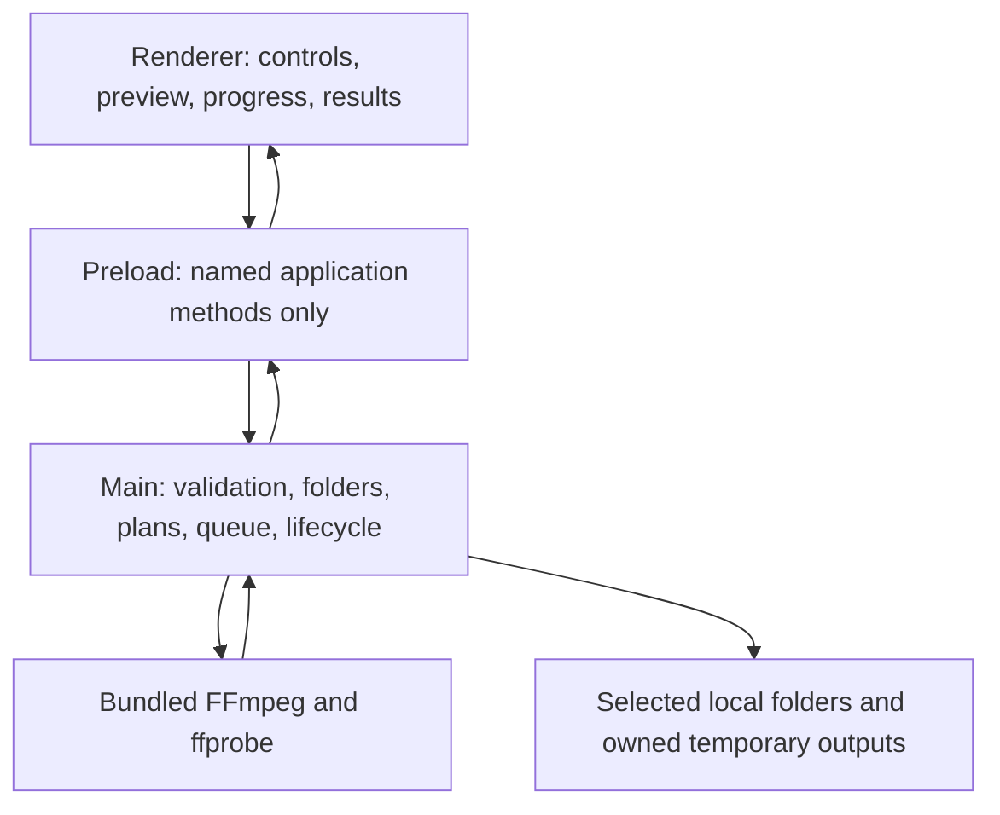

# Project architecture

## Field corrections and current verification

The canonical builder preserves exact MP4 stream creation_time as SOURCE_CREATION_TIME on the same mapped Matroska track; validation requires the exact value and refuses conflicting aliases. Inspection derives the visible notice, including on cache hits, and preservation policy2 invalidates prior policy evidence. Other metadata/content checks remain strict. Source identity remains conservative; failures add bounded field/checkpoint/expected/actual diagnostics to local results without new IPC authority.

The current helper is CQ29 under Decision17; six ordinary defaults and saved values are unchanged. The fresh packaged source/resources match checkpoint7b41c0f and pass actual extracted runtime checks. Final disposition is in the September24 M report.

## Amended L architecture — September 20, 2026

The existing main-owned plan/queue remains authoritative. Preferences store local folder strings and per-profile settings, never folder/plan tokens. Main revalidates restored folders and issues fresh identities on each process start. Version1 records remain readable; version2 adds optional strict recipeId and is preserved as unknown by older readers. Missing paths or unavailable profiles/recipes stay visible; no automatic create, inspect, encode or fallback occurs.

Generated files remain excluded by default. Separate explicit actions distinguish ambiguous legacy classification overrides from deliberate generated-output re-encoding. Re-encode authority binds only chosen file IDs, the current plan and complete inspected identity; source revalidation invalidates changed/empty/deleted input. It is not persisted. New results receive normal K provenance/publication protections. The optional bounded FFMPEG_ENCODER_GENERATION description is validated descriptive data, not cleanup authority or authenticated history; absent/contradictory data degrades to unknown without losing generated recognition.

media.cjs now supplies canonical encoderContribution/describeRecipe and the actual prepared production argv. Main exposes narrow read-only recipe/details APIs; renderer cannot submit argv. Preparation freezes arguments with one labelled temporary-output placeholder; execution substitutes only its final staging path and exposes the resulting actual invocation. JSON argument arrays avoid pretending to be a Windows shell command. Three exact global application provenance tags may be replaced on re-encoding; ordinary, stream and chapter metadata remain subject to preservation checks.

Archive Quality is a separate HEVC helper (P7/UHQ/fullres/VBR-CQ29/bf4/B-ref each), with editable ordinary preset/CQ and visible additional options. Tested Defaults remain unchanged. The recipe gets96-frame8/10-bit encode/probe/decode checks plus complete picture types/four-B structure; ordinary profiles retain two-frame checks. Device checks are not a perceptual benchmark. See Decision17 for the current CQ choice, Decision15 for historical selection and reference-graph/Ada limits.

Current through September24: J/K/L are accepted; fresh M runtime passes and final independent acceptance is being reconciled. Immutable local0.5 retains I acceptance. Dated reports hold the requirement/evidence maps.

## Identity and purpose

FFmpeg Encoder Desktop App is an existing Electron application for Ahmed's Windows computer. It makes controlled, sequential local video encoding understandable through folder selection, explicit encoder settings, visible progress, and per-file results. The approved re-entry completes a durable CPU/NVIDIA SDR application and a locally verified portable ZIP. It does not add background encoding, network services, cloud uploads, distributed workers, or an unrestricted FFmpeg command editor.

Ahmed owns product direction and acceptance. The Mother/Development Thread supplied the re-entry handoff and reviewed the amended plan. Codex is authorized to implement and diagnose the approved local work at project level, preserving evidence and recoverable checkpoints.

## Verified legacy implementation

At baseline `c30d335`, `main.js` creates an Electron window with Node integration enabled and context isolation disabled. It opens folder dialogs, launches `./ffmpeg/ffmpeg.exe`, accepts renderer-supplied input/output paths, and hardcodes libx265/slow/CRF 25 with x265 tuning and audio copy. It also runs an FFmpeg version check on startup.

`renderer.js` directly imports filesystem/path modules, scans the input folder synchronously, filters extensions, sorts the files, controls the sequential loop, parses raw stderr, and updates the UI. The visible settings are not wired into the main encode arguments. CSS is embedded in `index.html`.

This is a functional prototype, not a proven security boundary. Historical documents describe safe cancellation and exclusive main-process OS access, but the baseline source has renderer filesystem access, premature child-handle clearing, and incomplete rejection/error handling. Keep those historical assertions in their archive; do not carry them forward as present facts.

## Implemented ownership at milestone F

Main is the authority for job state. The renderer cannot select arbitrary executables or pass arbitrary arguments, perform direct filesystem operations, or invoke arbitrary IPC channels. Preload exposes capabilities, choose-input/output, prepare-batch, treat-as-original, start-plan, cancel-batch, get-snapshot, and subscribe-to-updates methods. Folder/plan/job identifiers originate in main. Exact implementation names can be documented as they are introduced; these are the approved behavioral contracts.

Encoding uses one sequential queue. Preparation may use two independent inspection workers, each with at most one media child and sequential frame windows; archive identity reads remain serialized. Each child remains associated with its job and batch until close and finalization settle. Shared infrastructure errors abort peers and stop admission while preserving a failed result. Cancellation awaits every worker and cache finalization before restart. Event handlers cannot change newer batches. An active-window close offers “Cancel encoding and exit” or “Keep application open.” Renderer loss cancels work; no invisible encoding session remains.

## Inspection evidence reuse (J)

Main derives a current source identity in source-identity.cjs, asks the bounded optional storage-eligibility.cjs helper whether persistent reuse is supported, and consults inspection-cache.cjs. The cache contains normalized metadata and bounded decoded-frame evidence, not permissions, paths supplied by the renderer, plans, settings, destination absence or hardware availability. inspection.cjs reconstructs policy decisions from that evidence on each hit. Missing or unusable cache/helper state falls back to fresh inspection.

The evidence namespace binds the actual ffprobe binary hash, policy/schema versions, canonical file identity and a versioned sparse digest. Entries are independently bounded, atomically stored and evicted only inside the cache namespace. Output provenance has its separate provenance-v1 lifetime; preferences have their own independent namespace. Current before/after source, mapping, settings, hardware and destination checks still apply. A cooperative local-file identity is not a claim of cryptographic whole-file equality against deliberately concealed changes.

## Media and output boundary

Main inspects top-level regular files with supported extensions, resolves selected folders, prepares effective settings, and calculates destination names before starting. Input and output may coincide on verified ordinary local fixed NTFS. All baseline input names/identities remain protected destinations; generated and ambiguous legacy outputs are classified before admission. Duplicate input stems that would share a destination require an explicit preview selection; output files already present are skipped.

The chosen non-attached primary video stream is encoded. Supported audio/subtitle streams, attachments, chapters, metadata, and dispositions are preserved. Unsupported preservation cases are explicit failures rather than implicit content loss. Color classification is metadata-based and conservative: supported SDR proceeds, detected HDR is unsupported, and unresolved color evidence is reported as ambiguous/unsupported. See the Technical Reference for exact criteria.

Each job encodes into its own temporary destination, validates completion using the process result and ffprobe, and publishes without overwriting a file that appeared during the encode. Cleanup may remove only that job's bound owned files; uncertain unbound/replaced partial objects are retained with notice. A completed or pre-existing file is never a cleanup target.

## Security and module sequencing

First establish a narrow preload, context isolation, renderer sandboxing, validated sender/payload IPC, fixed binary paths, and shell-free child execution. Prove this architecture while using a restricted local file entry point. Milestone F proved that boundary at checkpoint b7d56df. Milestone G now serves only three exact GET URLs under `app://encoder/` (index.html, styles.css, renderer.js). The dedicated session rejects every other request; response CSP prevents inline scripts, frames, connections and base/form changes. Native tests verify these controls, denied permission/popups, and renderer navigation cancellation. The independent sequence preserves regression attribution.

Keep pure media/profile validation and telemetry parsing separate from Electron bindings. Keep HTML for structure, CSS for layout, renderer code for interaction, and main services for system work. Comments should explain ownership and the reason for constraints so future programmers can extend the app safely.

## Project memory

Current State records what exists now. Roadmap records milestone progress. Technical Reference owns media/IPC behavior. Security and Testing records required properties and evidence. Session Summary records decisions and continuity. Dated Execution Summaries record actual actions, checks, and checkpoints. The Archive preserves the historical record; canonical PBS remains external.

## Portable runtime layout

The Windows x64 ZIP contains a branded Electron executable, its runtime assets, an exact application ASAR and resources/ffmpeg/ffmpeg.exe plus ffprobe.exe. Binary provenance, portable instructions and third-party notices accompany it. No development packages or prior data are included. Main configures both userData and sessionData before readiness and the single-instance lock: packaged data lives beside the executable, while active 0.6 development defaults to data-next-0.6 to isolate accepted 0.5 state. An explicit --user-data-dir remains supported. Paths never depend on the working directory or a global FFmpeg installation.

The direct pinned Packager builder and existing 7-Zip produce fresh, independently verified artifacts. The portable test launches the actual extracted executable and records hashes, runtime/process paths, network restrictions and workflow results; see the I and September24 M reports for their same-machine scope.

## Provenance and publication (K)

provenance.cjs classifies reserved metadata and all historical suffixes independently of hardware. Main issues identity/plan-bound legacy overrides, creates output UUIDs and persists intent before encoding. Immutable bounded checksummed intent/published records identify outputs and support read-only pending recovery; they never authorize cleanup. outputs.cjs owns exact stage objects privately, seals successful outputs before ffprobe, checks source/directory identity and publishes atomically/exclusively for same-folder mode. Distinct folders retain explicit exclusive-copy fallback. Final-bookkeeping failure preserves completed output; cleanup retains anything whose ownership cannot be established. The Same Folder report records cooperative filesystem and marker-erasure limits.
