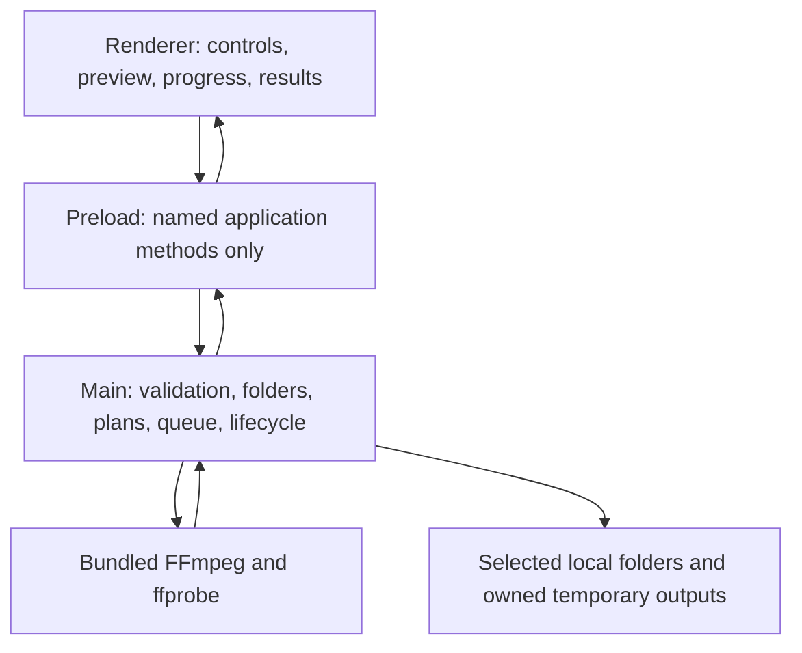

# Project architecture

Created September 6–7, 2026. State at creation: preserved legacy baseline; modernization approved and pending.

## Identity and purpose

FFmpeg Encoder Desktop App is an existing Electron application for Ahmed's Windows computer. It makes controlled, sequential local video encoding understandable through folder selection, explicit encoder settings, visible progress, and per-file results. The approved re-entry completes a durable CPU/NVIDIA SDR application and a locally verified portable ZIP. It does not add background encoding, network services, cloud uploads, distributed workers, or an unrestricted FFmpeg command editor.

Ahmed owns product direction and acceptance. The Mother/Development Thread supplied the re-entry handoff and reviewed the amended plan. Codex is authorized to implement and diagnose the approved local work at project level, preserving evidence and recoverable checkpoints.

## Verified legacy implementation

At baseline `c30d335`, `main.js` creates an Electron window with Node integration enabled and context isolation disabled. It opens folder dialogs, launches `./ffmpeg/ffmpeg.exe`, accepts renderer-supplied input/output paths, and hardcodes libx265/slow/CRF 25 with x265 tuning and audio copy. It also runs an FFmpeg version check on startup.

`renderer.js` directly imports filesystem/path modules, scans the input folder synchronously, filters extensions, sorts the files, controls the sequential loop, parses raw stderr, and updates the UI. The visible settings are not wired into the main encode arguments. CSS is embedded in `index.html`.

This is a functional prototype, not a proven security boundary. Historical documents describe safe cancellation and exclusive main-process OS access, but the current source has renderer filesystem access, premature child-handle clearing, and incomplete rejection/error handling. Keep those historical assertions in their archive; do not carry them forward as present facts.

## Target ownership

Main is the authority for job state. The renderer cannot select arbitrary executables or pass arbitrary arguments, perform direct filesystem operations, or invoke arbitrary IPC channels. Preload exposes capabilities, choose-input/output, prepare-batch, start-plan, cancel-batch, get-snapshot, and subscribe-to-updates methods. Folder/plan/job identifiers originate in main. Exact implementation names can be documented as they are introduced; these are the approved behavioral contracts.

A single queue owns a single active child. Each child remains associated with its job and batch until the close event and cleanup settle. Event handlers must not clear newer state. Cancelling prevents the next job from starting and prevents restart until the old process is gone. An active-window close offers “Cancel encoding and exit” or “Keep application open.” Renderer loss cancels work; no invisible encoding session remains.

## Media and output boundary

Main inspects top-level regular files with supported extensions, resolves selected folders, prepares effective settings, and calculates destination names before starting. Input and output folders must be distinct. Duplicate input stems that would share a destination require an explicit preview selection; output files already present are skipped.

The chosen non-attached primary video stream is encoded. Supported audio/subtitle streams, attachments, chapters, metadata, and dispositions are preserved. Unsupported preservation cases are explicit failures rather than implicit content loss. Color classification is metadata-based and conservative: supported SDR proceeds, detected HDR is unsupported, and unresolved color evidence is reported as ambiguous/unsupported. See the Technical Reference for exact criteria.

Each job encodes into its own temporary destination, validates completion using the process result and ffprobe, and publishes without overwriting a file that appeared during the encode. Cleanup may remove only that job's incomplete owned files. A completed or pre-existing file is never a cleanup target.

## Security and module sequencing

First establish a narrow preload, context isolation, renderer sandboxing, validated sender/payload IPC, fixed binary paths, and shell-free child execution. Prove this architecture while using a restricted local file entry point. Introduce the custom `app://` protocol later as its own checkpoint with an asset allowlist, CSP, and navigation/traversal tests. This sequencing preserves regression attribution.

Keep pure media/profile validation and telemetry parsing separate from Electron bindings. Keep HTML for structure, CSS for layout, renderer code for interaction, and main services for system work. Comments should explain ownership and the reason for constraints so future programmers can extend the app safely.

## Project memory

Current State records what exists now. Roadmap records milestone progress. Technical Reference owns media/IPC behavior. Security and Testing records required properties and evidence. Session Summary records decisions and continuity. Dated Execution Summaries record actual actions, checks, and checkpoints. The Archive preserves the historical record; canonical PBS remains external.
