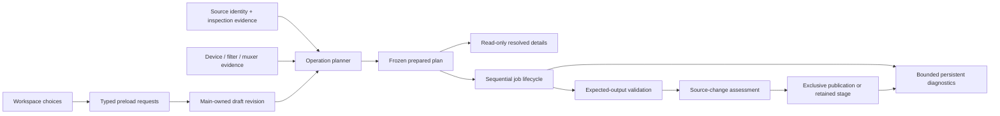
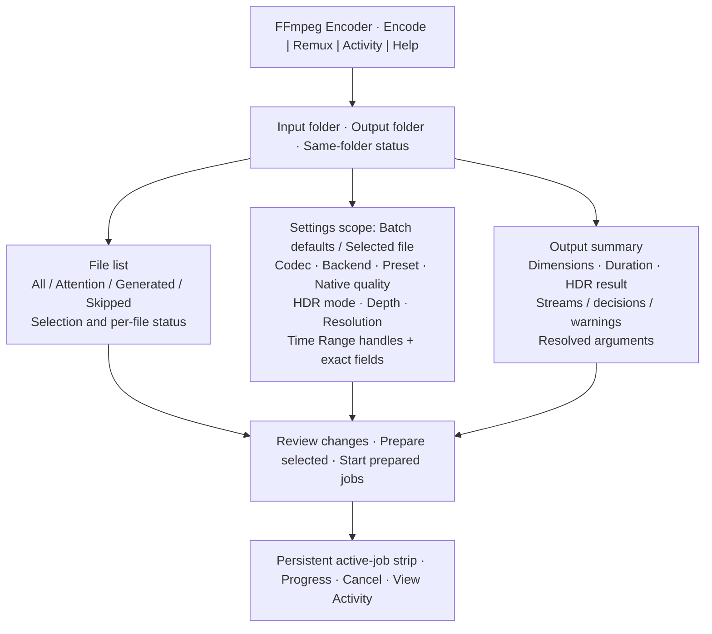

> **Current governing state — October 26, 2026 (Cairo): documentation-only reconciliation; development remains temporarily paused.** The approved product requirements are preserved. Amendment32 controls final-source QA and both installer/portable qualification; amendment33 controls the non-HDR scope, milestone order and later temporary pause. Earlier current/readback/review-stop wording below describes its dated checkpoint and grants no present execution. Resume engineering only after later owner/Blue continuation. [Affected-document inventory and recovery handoff](34_0.7_Paused_Documentation_Reconciliation_2026-10-26.md).

> **Historical readback - October 23:** source `38392493973422eaf2c075a9af6e1e1656f7594c` replaces default seed-hash membership with the reviewed finite content-derived CPU HDR family. Fitting, first default holdouts and actual refusals passed. [Current State](01_Current_State.md), [Continuation](10_Continuation_State.md) and the [content-eligibility receipt](Execution%20Summaries/2026-10-23_CPU_HDR_Content_Eligibility.md) own exact support, authority and final private-checkpoint readback. Stop for Blue review before broader work; 0.7 remains unaccepted. The previous checkpoint and approved design/scope history below remain dated evidence.

> **Historical previous checkpoint — CPU HDR preservation and device observations, October23.** Reviewed code `c3168053182e7df6e82fc945935aa3e5f3792faa` completes only the two-seed CPU PQ/HLG normal-service family and main-private observation plumbing (Plan31 Slice4a). Final regression:1328 passed,0failed,1Windows fixture skipped. STOP here for Blue review before broader work; no automatic successor. [Evidence receipt](Execution%20Summaries/2026-10-23_0.7_Slice4a_CPU_HDR_and_Observation.md) and [Continuation](10_Continuation_State.md) own exact support, final checkpoint readback, remaining work and limits. All43 requirements and protected accepted/default/benchmark state remain; Security Cloud is excluded.

> The approved Goal23/amendment28 scope is retained. October11–13 pause and later Slice1–3 approvals remain dated history. Ahmed renewed continuation and moved the development home to Thread2 on October23 at06:14UTC, with Blue coordinating. This dated body preserves original scope; the current bounded Slice4a authority is in Continuation and does not require repeating original approval.

> Historical reviewed plan, preserved verbatim from the October 11 conversation. Implementation was subsequently authorized by [23_Approved_0.7_Candidate_Goal.md](23_Approved_0.7_Candidate_Goal.md). That approval superseded this document's planning-only status, trimmed-audio default, App Settings placement, and fixed F: storage ceiling. Do not reinterpret the old draft Goal as the complete execution scope.

# FFmpeg Encoder 0.7 — Technical Plan for Review

**Status:** Proposed; implementation is not authorized.  
**Date:** October 11, 2026.  
**Product authority:** Ahmed.  
**Review:** Ahmed and Blue.  
**Requested planning executor:** Codex — GPT‑6 Astra.  
**Surface:** Codex Plan Mode.

## 1. Recommendation and verified starting point

Build 0.7 around the accepted main-owned planning and execution architecture. Extend its media evidence and output-validation contracts before adding hardware, HDR, transformation and remux features. Introduce dedicated workspaces early, then complete their visual refinement after the workflows function.

The intended endpoint is a **locally qualified 0.7 candidate**, with every selected capability implemented within an explicit support matrix. AMD/Intel execution, independent-machine evidence, HDR-display judgment and Ahmed’s visual acceptance remain separately identifiable gates. Their absence must not be reported as success.

### Decisions incorporated from this review

- **ctime-only:** retain a completed, otherwise valid output and warn. Continue bounded source checks; **no mandatory whole-file pre-read**.
- **Storage:** at most **24 GiB additional project-owned data**, including at most **6 GiB downloads**. Maintain **25 GiB free on every affected volume**.
- **Locations:** code remains on D:. New media fixtures and test outputs use separately named, owned subfolders under `F:\FFmpeg Encoder Project supplied videos`.
- **Acceptance:** candidate first; missing external evidence requires a later explicit acceptance decision.
- **iPhone/HDR:** retain HDR by default where supported. Distinguish HLG preservation from applying or retaining Dolby Vision metadata. SDR is always an explicit conversion.
- Benchmark recommendations, defaults and recipes remain on their separate, paused research track.

### Source authority and reconciliation

The current [intended roadmap](https://app.notion.com/p/3e5bd7ade63b81d5a7fcd46a0a753aae), [Human Roadmap](https://app.notion.com/p/3d6bd7ade63b817e9a55d61cf203bb9e), [feature board](https://app.notion.com/p/60570a27dd79480f9e567e0dd8db6d8e), [project hub](https://app.notion.com/p/3f2bd7ade63b8137a25ccedb3c87c381) and relevant feature cards were accessible and inspected.

Their October 11 scope supersedes older deferrals. They establish intended behavior; Git, source and acceptance records establish implementation.

| Item | Verified position |
|---|---|
| Working branch | `codex/pre-0.7-benchmark` |
| HEAD | `c08e117256d93371871c481d3ca56468fe10fbec` |
| Accepted 0.6 | `local-v0.6.0` → `be92b12205d299b6d3bdcc2fd4b2e3a02f928862` |
| Accepted 0.5 | `local-v0.5.0` → `f3efdeb47531106a740efb55299c5251b9a7a505` |
| Production drift | Checked production paths still match accepted 0.6 |
| Accepted 0.6 ZIP | Present, **321,231,543 bytes**; historical SHA-256 evidence retained, not rehashed in this task |
| Benchmark | Live state remains `awaiting-calibration-judgment`; finalists `null`; **139** encode invocations |
| Current runtime | App 0.6.0; Electron 44.2.0; FFmpeg/ffprobe 9.0.1; Packager 20.3.0; Playwright 1.63.0 |
| Observed GPU | RTX 5060; Windows driver 32.0.16.1714; no AMD/Intel adapter observed |

The benchmark’s [pause record](<D:/Codex Projects/FFmpeg Encoder/0- Documentation/21_Phase1_Pause_Resume.md>) remains authoritative for its pending visual judgment and preservation boundary. Its older feature deferrals do not control this new scope. No comparison mapping was exposed or changed.

### Supplied-media findings

Five files total **7,029,623,086 bytes**. Bounded metadata probes succeeded; before/after source identity observations matched. These are metadata observations, not decode, application-reproduction or acceptance results.

| Supplied file | Observed characteristics | Planning consequence |
|---|---|---|
| `Freelanzwya Sep 26th Live Workshop.mp4` | Resolve encoder tag; AV1, 1080p60, 8-bit BT.709; AAC; linked `tmcd` timecode track | Strong Resolve-origin candidate. Current data-stream preservation policy presents a concrete barrier to reproduce. |
| `107_new.mp4` | H.264 High, 852×480, 25 fps; **SAR 640:639**, DAR 16:9; AAC; absent color fields | Mandatory aspect-ratio and missing-color case. |
| `108_new.mp4` | H.264 High, 1280×720, 25 fps; AAC; absent color fields | Independent compatibility candidate. |
| `109_new.mp4` | Similar broad format to 108, independently identified | Do not assume the same failure or historical episode mapping. |
| `iPhone 13 Pro 4K60p.mov` | 21.658 s; HEVC Main10, 3840×2160; BT.2020/HLG; Dolby Vision profile 8, compatibility ID 4, RPU present, no enhancement layer; AAC and three `mebx` data streams | Real supplied HDR/Dolby Vision compatibility case. SAR is unreported. Origin/licensing and full decoded behavior remain unverified. |

The iPhone file contains location metadata. Raw probe evidence remains private; diagnostic exports must redact it.

The [historical Resolve report](https://app.notion.com/p/3ecbd7ade63b81c88d86dfbd979fdb2f) recalls a data-stream message but contains no exact error. The supplied Resolve candidate’s production-equivalent ffprobe call returned zero with no error-level stderr. This supports investigating preservation policy, **not claiming a decoder failure**.

The exact laptop episode, historical error and selected settings remain unidentified. Missing color tags are an observation, not a proven cause.

## 2. Shared architecture and trust contract

### Preserve the accepted foundations

Retain:

- Sandboxed renderer, context isolation, narrow validated preload APIs.
- Main-owned folders, source identities, capabilities, plans and processes.
- Fixed bundled executables and argument arrays without shell construction.
- Two bounded inspection workers and one active media job.
- Exact child ownership through close, cancellation and cleanup.
- No-overwrite publication, source reservation and owned-only cleanup.
- Generated-output exclusion and preparation-scoped intentional re-encoding.
- Canonical encoder descriptions, helpers and resolved arguments.
- Unchanged ordinary CPU/NVIDIA settings and Archive CQ29 recipe.

The actual [media builder](<D:/Codex Projects/FFmpeg Encoder/src/media.cjs>) assumes CPU/NVIDIA settings and Matroska encoding. The [inspection implementation](<D:/Codex Projects/FFmpeg Encoder/src/inspection.cjs>) drops details now needed for HDR, geometry and remux. The [service](<D:/Codex Projects/FFmpeg Encoder/src/encoder-service.cjs>) already provides the lifecycle authority to extend.

**Important compatibility rule:** ordinary full-video, Keep Source, unchanged-SDR CPU/NVIDIA jobs retain a dedicated compatibility path. They must not acquire new filters, timestamp resets or upload stages merely because the new architecture exists.

### Proposed data flow

Use six distinct concepts:

| Concept | Responsibility |
|---|---|
| **Source evidence** | Identity, detected container, streams/groups, timeline, geometry, color and HDR evidence with uncertainty |
| **Capability evidence** | Exact device/runtime/profile/depth/rate-control/transform support and test status |
| **Requested operation** | Typed Encode or Remux choices, per-file range and explicit preservation decisions |
| **Prepared plan** | Frozen request, evidence revisions, stream map, destination, canonical argv and validation contract |
| **Job result** | Media validity, source-change observations, publication disposition and warnings |
| **Incident** | Durable explanation correlated with session, plan, file, job and invocation |

Extend normalized inspection to retain bounded, typed representations of profile/codec tags, rational timestamps, SAR/DAR, orientation, detailed HDR metadata, stream groups and relevant container relationships. Unknown and malformed values remain distinct.

### Operations and invalidation

**Encode:** encoder settings, Full or one interval, Keep Source or selected resolution, color/HDR operation, selected depth and explicit preservation decisions.

**Remux:** target MKV/MP4/MOV, full video, selected program where applicable, and a complete preservation decision map. MPEG-TS is an input in the initial matrix; TS output is not required.

Changing source evidence, backend, range, resolution, HDR mode, depth, target container or stream decisions invalidates the prepared plan and temporary generated-output grants. Cosmetic navigation, filtering and expanding details do not.

Execution uses the frozen plan. Only the disclosed owned staging path is assigned at start. The displayed arguments and executed arguments come from that same plan.

### Interfaces and persistence

Extend existing named APIs with narrowly scoped operations for:

- Updating a workspace draft and preparing its revision.
- Requesting/rechecking a specific backend capability.
- Reading prepared media, preservation and argument details.
- Listing incident summaries, reading one incident, revealing the owned logs location and exporting selected incidents through a native save dialog.

No API accepts arbitrary executable paths, command strings, filtergraphs, filesystem paths, vendor dictionaries or unrestricted IPC channel names.

Use isolated 0.7 development data. Version preferences, inspection evidence, descriptive provenance and diagnostics independently. Read older settings through explicit migrations; never overwrite accepted 0.6 data. Do not persist prepared plans or temporary re-encode authority across restart.

Retain existing output names for unchanged operations. Transformed jobs add readable resolution/HDR/range descriptors plus a short deterministic transform identifier. Identical destinations still skip or conflict; never generate numbered overwrite alternatives silently.

### O — Persistent diagnostics and source-change policy

Extend existing terminal batch JSON logs; they are already shipped functionality.

New diagnostics should cover admission, inspection, unsupported-only batches, preparation, capability checks, invocation, validation, publication, cancellation and interrupted-session recovery.

Recommended limits:

- 30-day retention or 200 MiB, whichever is reached first.
- 64 KiB structured event ceiling.
- 256 KiB bounded stderr per invocation, with truncation recorded.
- Durable stage-transition records; rate-limited progress persistence.
- Active incidents protected from rotation until terminal.
- No automatic upload, crash-dump upload or background reporting.

Record reason codes, versions, requested and resolved settings, relevant bounded probe evidence, exit/signal, changed identity fields and output disposition. Reviewable exports use stable path aliases and remove location/device-identifying metadata. Raw diagnostic text is rendered as text, never HTML.

If logging fails, expose incomplete history. If startup storage is unwritable, show copyable failure details rather than claiming persistence. Hard kills and power loss may leave only the last durable stage.

#### Selected ctime behavior

`ctimeNs` is filesystem status-change time; `birthtimeNs` and media `creation_time` are different fields.

| Evidence after encode | Required result |
|---|---|
| Source observations match; output valid | Normal exclusive publication |
| **Only ctime differs**, complete comparable bounded observations, output valid | **Saved with warning**, with before/after evidence |
| Size, mtime, file ID, path/handle identity, birthtime or sampled bytes differ | Distinct source-change non-success |
| Stronger available evidence demonstrates changed content | Content-integrity non-success |
| Identity read incomplete or internally inconsistent | Do not pretend this is ctime-only; retain completed work safely if publication cannot be justified |
| Output invalid | Output-validation failure regardless of ctime |
| Destination appears | No overwrite; report collision and retained-stage disposition |
| Cancellation before completion | Existing cancellation/owned-cleanup rules |
| Cancellation after valid completion, before publication | Stop the queue; retain completed work safely with an explicit result |
| Publication already committed | Cancellation never deletes the completed output |

Suggested warning:

> Output saved. The source’s filesystem change time changed. Bounded checks did not demonstrate another change, but cannot rule out changes outside the sampled regions.

Do not remove ctime globally from cache keys, preparation freshness or generated-output authority.

The deterministic unsampled-edit test must honestly produce **warning plus uncertainty** when production’s bounded observations cannot distinguish it. Separate tests with genuine stronger mismatch evidence exercise the non-success branch. Test-harness knowledge is not an imaginary production detector.

A stronger full-hash mode remains a separate proposal, not a default or prerequisite. A post-only hash cannot establish equality to previously unread bytes.

#### Refused inputs

Reproduce Resolve and laptop cases separately in later execution, initially against the accepted runtime in isolated application data.

- Preserve Resolve’s linked timecode evidence. A copied timecode string is not automatically equivalent to its timed track.
- For unrepresentable ancillary data, offer only a **named, per-file, explicitly acknowledged omission** where implemented; otherwise give a precise refusal and compatible alternative.
- Never introduce a global “ignore data streams” switch.
- Treat missing color evidence through the inspection/classification contract; do not automatically assign BT.709 based on codec, resolution or filenames.
- Keep the Samsung `SOURCE_CREATION_TIME` alias regression and conflict rejection unchanged.

The laptop mapping remains a bounded evidence gap, not a reason to stop unrelated work.

## 3. Hardware, HDR and media workflows

### Runtime maintenance

In later execution, trial **Electron 44.7.0** and paired **FFmpeg/ffprobe 9.0.2** in separate checkpoints before feature qualification. Preserve the accepted artifact and the benchmark’s pinned runtime.

Electron’s maintenance release includes upstream component fixes. FFmpeg 9.0.2 includes relevant MOV bounds, Dolby Vision metadata, duration and scaler fixes. These justify trials; they do not prove the supplied-file problems are solved. [Electron release](https://releases.electronjs.org/release/v44.7.0), [FFmpeg changelog](https://raw.githubusercontent.com/FFmpeg/FFmpeg/n9.0.2/Changelog).

Each trial needs version/hash/provenance records, affected baseline tests and its own rollback. Keep Packager and Playwright unchanged unless an actual compatibility or security reason emerges.

The bundled FFmpeg is GPL-3.0-or-later. About/notices must reflect that; the existing upstream source archive is not established as complete corresponding source for the entire static distribution. Public distribution remains a separate gate.

### P.A — AMF and QSV

The six wrappers are compiled into the current build. That is **advertised support**, not hardware acceptance.

| Backend | Initial implemented codec/depth cells | Native controls |
|---|---|---|
| AMD AMF H.264 | Progressive 4:2:0, 8-bit | Native quality preset; CQP; separately qualified QVBR |
| AMD AMF HEVC | Progressive 4:2:0, 8/10-bit | Same control families, codec-specific validation |
| AMD AMF AV1 | Progressive 4:2:0, 8/10-bit | AV1-specific QP scale and qualified QVBR |
| Intel QSV H.264 | Progressive 4:2:0, 8-bit | Native preset; qualified ICQ or explicit CQP |
| Intel QSV HEVC | Progressive 4:2:0, 8/10-bit | ICQ/CQP validated independently |
| Intel QSV AV1 | Progressive 4:2:0, 8/10-bit | Codec-specific CQP; ICQ only where actual runtime confirms it |

Do not infer ten-bit H.264 output from accepting a ten-bit input surface. Do not expand new backends to 12-bit, 4:2:2, 4:4:4, alpha or interlaced output without qualification.

AMD’s generation table contains significant differences and exceptions; Intel’s runtime and graphics generations also differ. A model name, AV1 decoder or compiled encoder is insufficient. [AMD capabilities](https://github.com/GPUOpen-LibrariesAndSDKs/AMF/wiki/GPU-and-APU-HW-Features-and-Support), [Intel capabilities](https://www.intel.com/content/www/us/en/docs/onevpl/developer-reference-media-intel-hardware/1-1/overview.html).

**Control policy**

- Preserve CPU CRF and NVIDIA CQ as their existing distinct controls.
- AMF exposes CQP I/P/B values where supported, or an explicitly selected QVBR quality value.
- QSV exposes ICQ or CQP with native semantics.
- Never translate these into a misleading common “quality number.”
- Derive help, defaults, provenance and arguments from the backend adapter.
- New backend seeds are labelled operational starting values until verified on hardware; they do not receive “Tested Default” claims prematurely.

Initial functional seeds: AMF balanced/transcoding, H.264/HEVC CQP24 and AV1 CQP128; QSV medium, H.264/HEVC ICQ25 or explicitly selected CQP24, AV1 CQP128. These are probe seeds, not archive-quality recommendations.

FFmpeg documents that QSV’s runtime can choose another rate-control mode. Qualification must inspect actual runtime evidence and reject substitution of an explicitly requested mode. [QSV rate control](https://ffmpeg.org/ffmpeg-codecs.html#QSV-Encoders).

**Capability lifecycle**

Use discovered → untested → verified/unavailable/stale states. Bind results to binary identity, adapter, driver/runtime, codec/profile, depth, rate-control mode and relevant transform.

Use cheap discovery at startup; absent optional GPUs produce compact unavailable reasons. Validate selected cells through bounded owned probes. A remembered unavailable choice remains visible; choosing CPU is an explicit action.

Proposed functional probes: 640×360, 30 fps, 60 frames; separate 8/10-bit cases; one child at a time; bounded encode/probe/decode timeouts. Require correct output, successful decode and requested-mode evidence. Resource failure means “not tested,” not “unsupported.”

Use software decoding and explicit transforms initially, followed by backend-specific packing/upload. Preserve the no-transform compatibility path for accepted CPU/NVIDIA jobs. Hardware decoding and zero-copy optimization are not dependencies of this release.

### P.B — HDR contract

The initial core is progressive 10-bit 4:2:0 **PQ/HDR10 and HLG**, with separately qualified backend/container cells.

| Input | Keep HDR | Explicit SDR conversion |
|---|---|---|
| Coherent SDR, including ten-bit SDR | Existing SDR behavior | No HDR conversion required |
| PQ/HDR10 | HEVC Main10; preserve valid signal/static metadata through verified backend mechanisms | Actual qualified pixel transformation to BT.709 |
| HLG | HEVC Main10 with HLG signaling | Explicit HLG interpretation and tone mapping |
| Supplied Dolby Vision-compatible HLG | Recommended HLG route with clear loss of DV metadata; qualified DV-aware PQ alternative | Deliberate conversion only |
| Dolby Vision profile 5/7/FEL or unknown dynamic formats | Unsupported unless that exact path is separately implemented and qualified | No generic “ignore Dolby Vision” fallback |
| Contradictory/missing essential HDR evidence | Explain and block the unsupported interpretation | Do not guess transfer/primaries |

For retained HDR, validate bit depth, primaries, transfer, matrix, range, applicable static metadata and container/bitstream signaling. Do not fabricate mastering-display values or infer HDR from ten-bit pixels.

#### Recommended iPhone behavior

For the supplied profile-8/compatibility-4 sample, recommend:

**Keep HDR — HLG**

> HDR retained as HLG. Dolby Vision dynamic metadata will not be retained.

This re-encodes its compatible HLG base layer as HEVC Main10. It does not silently select SDR or claim Dolby Vision preservation. Keep the user’s selected encoder settings visible and editable; no new quality default or fixed reduction target is inferred from the benchmark.

Also qualify:

**Keep HDR — Dolby Vision-aware conversion to PQ**

Use supported Dolby Vision reconstruction in libplacebo, then encode BT.2020/PQ as HEVC Main10. Dolby information is applied where supported, then not retained as Dolby Vision. FFmpeg explicitly distinguishes applying the RPU from retaining it. [FFmpeg libplacebo behavior](https://ffmpeg.org/ffmpeg-filters.html#libplacebo), [pinned filter source](https://raw.githubusercontent.com/FFmpeg/FFmpeg/n9.0.1/libavfilter/vf_libplacebo.c).

Proposed fixed contribution includes `apply_dolbyvision=1`, BT.2020/PQ, limited range, ten-bit output, no FPS conversion, no debanding or contrast enhancement, and no adaptive peak-history estimator. It requires a working Vulkan path. Do not invent an unsupported target-peak option.

Call the result **PQ HDR**, not automatically HDR10 or Dolby Vision. Its actual static metadata and target interpretation must be established.

**Bounded qualification:** two four-second windows, initially 1–5 s and 15–19 s, with:

1. Direct HLG-base output.
2. PQ conversion with Dolby processing off.
3. The same PQ conversion with Dolby processing on.

Allow at most two full-sample confirmations afterward. Reserve up to 2 GiB inside the development output budget. Measure validity, signaling, cadence, sizes, time and playback; evaluate visible HDR differences where a suitable display exists. Do not require the on/off pair to differ or claim an advantage merely because metadata was consumed.

The HLG route remains the initial recommendation unless the alternative demonstrates a practical benefit. If the PQ contract cannot be made stable and explainable, record the concrete limitation; do not substitute SDR or promise full Dolby Vision support.

The three `mebx` tracks are a separate preservation issue. Selecting an HDR route does not authorize dropping them.

#### SDR transform

Use a versioned CPU baseline so CPU-only systems have a real path:

1. Explicit source interpretation and range/orientation.
2. Linear floating-point conversion.
3. Deliberate luminance compression and gamut conversion.
4. Optional downscaling in the defined high-precision graph.
5. BT.709 limited-range output, explicit dithering and depth.
6. Removal of specifically obsolete HDR metadata.

Initial engineering transform: Hable, 100-nit nominal SDR interpretation, explicit desaturation parameter and documented source-peak handling. For HLG, qualify the 1000-nit reference interpretation with system gamma 1.2; for PQ, use valid MaxCLL when appropriate or visibly state the source-peak assumption.

The local binary advertises the required zscale/tonemap options. Upstream zimg explains the HLG interpretation, but numeric fixtures must establish behavior of the pinned binary. [zimg operation](https://raw.githubusercontent.com/sekrit-twc/zimg/master/src/zimg/colorspace/operation_impl.cpp), [normalization](https://raw.githubusercontent.com/sekrit-twc/zimg/master/src/zimg/colorspace/gamma.cpp).

Default SDR output depth: H.264 eight-bit; HEVC/AV1 ten-bit where qualified. Show the conversion explicitly. Existing SDR depth behavior remains unchanged.

### P.C — Corpus acquisition

Later execution owns acquisition and qualification; no downloads occurred during planning.

Target a small authentic set:

- Two PQ/HDR10 clips with different content and frame rates.
- One non-Dolby HLG clip.
- The supplied Dolby Vision/HLG sample, privately retained.
- One additional legitimate dynamic-HDR negative case if available.
- Generated ramps, patches, timestamp and malformed-metadata fixtures.

Prioritize clearly licensed material such as [Netflix Open Content](https://opencontent.netflix.com/). EBU material is useful where its testing terms permit access. The Photography Blog/Kodi sample is not licensed merely because it is downloadable; the supplied filename does not prove identical provenance.

For every acquired fixture record origin, permission, retention/redistribution conditions, exact bytes, SHA-256 and probe/tool evidence. Prefer short files under 512 MiB; use a 1 GiB per-download ceiling and 6 GiB aggregate ceiling. Do not fetch large collections to extract a few seconds.

### Q.A — Resolution

Use orientation-aware bounding boxes:

| Choice | Landscape | Portrait |
|---|---:|---:|
| 2160p | 3840×2160 | 2160×3840 |
| 1440p | 2560×1440 | 1440×2560 |
| 1080p | 1920×1080 | 1080×1920 |
| 720p | 1280×720 | 720×1280 |

Calculate in display space using SAR and orientation; fit without upscaling. Show actual output dimensions. No automatic crop, stretch, padding, deinterlace or FPS conversion.

Keep Source preserves source geometry/SAR/orientation where supported. Resized output prefers square pixels with no more than 0.1% display-aspect error from integer alignment; otherwise use a qualified residual SAR or refuse the unsupported geometry.

The supplied 852×480/SAR640:639 file is a mandatory regression. Missing SAR is unknown, not a verified square-pixel value.

### Q.B — Time Range

Use **Full** by default, otherwise one interval per file:

- Inclusive start, exclusive end, finite integer microseconds.
- `0 ≤ start < end ≤ known duration`.
- Visible handles and precise timestamp fields.
- Range stays attached to the file; batch application is explicit.
- Requested and effective frame boundaries are visible.
- VFR uses presentation timestamps, not average-FPS arithmetic.
- Seek near the interval, then precisely discard/trim; do not decode eight hours to reach a late start.
- Progress and validation use the effective interval.

Copied audio remains packet-granular. Do not promise sample-exact cuts or silently transcode audio. Validate boundary error against the relevant video interval plus one audio packet, capped at 100 ms; reject combinations that cannot satisfy the contract. Preserve synchronization without accumulating drift.

Intersect/rebase chapters. Qualify subtitle overlap and decoder-state behavior; block range combinations that cannot faithfully preserve a selected subtitle track.

**Remux remains full-video-only in 0.7.** This avoids promising frame-accurate lossless trimming while fully delivering the selected Encode Time Range feature.

### Q.C — Remux matrix

Initial targets: MKV, MP4 and qualified MOV cases. Determine compatibility from actual streams and container structures.

| Direction | Initial positive cases | Important blockers |
|---|---|---|
| MP4 → MKV | Qualified H.264/HEVC/AV1 with compatible audio | Timed data, cover art, subtitle representations, track references |
| MKV → MP4 | Qualified video plus AAC/AC-3/E-AC-3 cells | ASS/SRT/PGS, attachments/fonts, unsupported tags/dispositions |
| TS → MP4 | Qualified single-program H.264/HEVC and audio | Multiple programs, discontinuities, teletext/data, missing timestamps |
| TS → MKV | Qualified H.264/HEVC/MPEG-2 and copied companion streams | Program/service structure and transport metadata |
| MOV → MP4/MKV | Individually qualified video/audio/container cells | `tmcd`, `mebx`, Apple metadata, rotation and HDR signaling |
| MP4/MKV → MOV | Bounded qualified cells | Target-specific codec and metadata restrictions |

Every item receives a visible disposition: preserved, equivalent representation, operation-required transformation, explicitly omitted, or unsupported.

No hidden transcode. Copy-compatible bitstream representation changes are allowed only when named and validated. Whole-container hashes are not a useful equality criterion after remux.

Target enablement requires both media preservation and provenance round-trip evidence. A successful simple MP4 cannot authorize every data/subtitle/attachment combination. Unqualified targets remain unavailable with an explanation.

## 4. Concrete workspace design

These are schematic planning artifacts, grounded in the current dark charcoal, orange and mint interface. They are not screenshots of implemented 0.7 behavior.

### Alternatives considered

| Direction | Strength | Trade-off |
|---|---|---|
| **Tabbed workbench — recommended** | Encode and Remux share familiar source/result patterns while keeping their controls distinct | Requires carefully maintained draft scope |
| Library-first inspector | Excellent for many per-file edits | Batch defaults can become less obvious |
| Task-focused two-pane layout | Simple at small sizes | More navigation to compare source, request and validation |

Use the **tabbed workbench**, with **Encode · Remux · Activity · Help**. Keep the native Windows title bar initially. Avoid custom window controls before the workflow is stable.

### Encode layout

At approximately 1440 px, use a 280 px file column, flexible settings area and 300 px output summary. At 1100 px, merge summary into the settings column. At the existing 640×480 minimum, use a single column with a collapsible file list, persistent selected-file identity and compact active-job strip.

Expert controls remain visible in the active encoding workspace. Help expands in flow or a focusable details panel; long argv never occupies a tiny tooltip.

### Remux layout

| Region | Contents |
|---|---|
| Top | Input/output locations and explicit source import/reuse |
| Left | Files, detected containers and readiness |
| Center | Target container; selected program; stream/metadata preservation table |
| Right or below | “Copied unchanged,” representation changes, explicit omissions and blockers |
| Footer | Prepare remux / Start; no preset or CRF/CQ controls |
| Details | Exact stream map, bitstream filters, timestamp policy and resolved arguments |

A Resolve file with a timecode conflict should show the specific track and why the target cannot preserve it, with a supported alternative or explicit named decision.

### Activity and Help

**Activity** combines current jobs and durable history. Rows distinguish success, saved-with-warning, skipped, cancelled, unsupported, failure and retained completed stage. Selecting a row shows its requested operation, actual execution, validation and incident evidence.

**Help** contains:

- Actual app, Electron, FFmpeg and ffprobe versions.
- Encoder availability and qualified support matrix.
- Accurate recipe explanations.
- Log location and reviewed export.
- Applicable licenses/credits.
- Local workflow explanations and reset actions.

Create the dedicated icon during R: an original frame/terminal motif using the existing orange/mint character, tested at Windows icon sizes. Do not imply official FFmpeg affiliation.

### State and interaction rules

- Encode and Remux have separate in-memory drafts.
- Batch defaults affect only inheriting files; overrides remain visible.
- Changing tabs never prepares, starts, cancels or clears a range.
- While work is active, navigation/history remain usable; changes to active job settings are locked.
- Generated-output filtering never authorizes re-encoding.
- Restart restores ordinary preferences but no prepared authority, omission confirmation or generated-output grant.
- Preparation shows why it is working and whether evidence was reused.
- Empty, unsupported-only and mixed batches each have an actionable state.
- Expected absent GPU hardware appears in capability details, not alarming startup banners.

Tabs use keyboard navigation and explicit activation; range handles keep stable focus order with exact-field alternatives. Follow the [WAI tabs](https://www.w3.org/WAI/ARIA/apg/patterns/tabs/) and [multi-thumb slider](https://www.w3.org/WAI/ARIA/apg/patterns/slider-multithumb/) patterns. Owner visual review remains separate from automated navigation/accessibility checks.

## 5. Delivery sequence, evidence, resources and draft Goal

### N–S sequence

| Milestone | Work packages and dependencies | Exit evidence | Containment |
|---|---|---|---|
| **N — Plan and shared contracts** | Review this plan; define operation/evidence/output contracts, state transitions, UI structure and fixture ledger | Independent architecture review; Ahmed/Blue amendments resolved | No production work until a separate Goal |
| **O — Trust and diagnostics** | Incident foundation; isolated runtime checkpoints; ctime disposition; separate refusal reproductions; normalized evidence expansion | Deterministic policy tests, restart-safe diagnostics, redaction/retention checks, evidence-backed refusal outcomes | Separate commits for runtimes, diagnostics, identity policy and compatibility |
| **P — Hardware and HDR** | AMF/QSV adapters and capability cells; PQ/HLG paths; bounded Dolby-aware qualification; lawful corpus | Builder/validation tests, local real endpoints, explicit vendor/display status | Backend and transform policy versions independently reversible |
| **Q — Focused workflows** | Geometry, one interval, preservation decisions and directional remux cells | Exact dimensions/timing/stream results, negative cases, lifecycle integration | No-transform route retained; unsupported combinations blocked |
| **R — Integrated design** | Workspaces, scope clarity, diagnostics/help/icon and responsive polish | Native flows, keyboard/resize evidence, repeated Ahmed visual review | UI revisions cannot alter main-owned job authority |
| **S — Candidate qualification** | Cross-feature matrix, long/repeated sessions, fresh portable ZIP and independent review | Candidate support matrix, artifact identity, complete evidence index and disclosed acceptance gaps | Preserve 0.6; do not create accepted0.7 tag automatically |

P and Q may proceed in parallel after the shared contracts and O foundations stabilize. Their integration is mandatory before R/S closure.

### Security at each milestone

- **N:** map renderer/main, parser, filesystem and child-process boundaries.
- **O:** treat diagnostic text as private/untrusted; keep ctime disposition separate from authority.
- **P:** validate device IDs and native controls; bound probes; reject silent mode/backend substitution.
- **Q:** validate ranges, dimensions, streams and container choices in main; defend source/destination aliases and publication races.
- **R:** preserve sender checks, text-safe rendering and exact local-asset allowlists; no arbitrary file route for convenience.
- **S:** independently verify those boundaries, rather than introducing security review only at the end.

All stages retain explanatory comments around trust decisions and non-obvious lifecycle behavior.

### Test and acceptance plan

Use three layers:

1. **Deterministic software tests:** schemas, builders, invalidation, negative inputs, diagnostic recovery and controlled filesystem dispositions.
2. **Actual local endpoints:** CPU/NVIDIA, supplied-media reproductions, HDR/scale/range/remux, cancellation and extracted portable operation.
3. **External/owner evidence:** AMD, Intel, independent Windows machine, HDR display and Ahmed’s interface judgment.

Mandatory combinations include:

- Full-video unchanged CPU/NVIDIA behavior and current Archive CQ29.
- HDR preserve/tone-map × Keep Source/downscale × Full/range.
- Anamorphic, portrait, ultrawide, odd dimensions and VFR/nonzero timestamps.
- Copied audio/subtitle/chapter boundaries.
- Compatible and incompatible remux directions.
- Same-folder provenance, explicit re-encode, replaced source, collision and restart.
- ctime-only warning, unsampled uncertainty, demonstrated content change and invalid output.
- Cancel during probing, encoding, validation, mux finalization and publication.
- Safe simulated low-space/output-unavailable failures.
- Corrupt cache/preferences/provenance/diagnostics with bounded recovery.
- Large mixed batches and repeated workspace navigation.

Use pairwise coverage plus explicit high-risk full combinations; avoid an indiscriminate Cartesian product.

For each supported cell retain input identity, exact versions/settings/argv, expected-output contract, output probe/decode evidence, warnings and result disposition. Hardware acceptance additionally records adapter and driver.

Fresh packaging must prove bundled tools, isolated extraction, alternate working directory, restricted PATH, process-level offline behavior, writable data/log paths, persistence and clean shutdown. A local portable run is not independent-machine acceptance.

### Independent storage plan

Observed free space during planning was approximately **57.63 GiB on D:** and **707.15 GiB on F:**. Recheck before execution and each material allocation.

| Allocation | Ceiling |
|---|---:|
| Downloaded originals | 6 GiB |
| Generated fixtures and necessary working copies | 2 GiB |
| Test outputs and temporary stages, including HDR comparison | 8 GiB |
| Runtime trials, builds and extracted candidates | 5 GiB |
| Logs, probes, screenshots and compact evidence | 1 GiB |
| Contingency | 2 GiB |
| **Total additional data** | **24 GiB** |

Proposed future owned media roots:

- `F:\FFmpeg Encoder Project supplied videos\_FFmpeg-0.7-Owned\downloads`
- `…\fixtures`
- `…\outputs`
- `…\staging`

These folders do not yet exist through this plan. Supplied originals remain outside them and unchanged. Every actual copy counts; temporary files and extracted packages count on the volume holding them.

Keep a separate storage/run ledger. Forecast peak allocation, enforce 25 GiB free on every affected volume and stop before violating a ceiling. Propose a smaller set if needed. Never delete benchmark assets or borrow its allowance.

Run one media job at a time; pause concurrent inspection/analysis when measuring timing. Use 5–20-second fixtures for routine integration, two-minute hardware qualification samples and one bounded long-job/late-seek session. Initial machine-validation estimate is **8–20 active hours**, excluding implementation and external waiting; reforecast from measured test costs rather than treating it as permission to run indefinitely.

### Git, rollback and documentation

After approval, use `codex/v0.7-candidate`, preserving the current benchmark branch and all accepted tags. Use separate local checkpoints for runtime changes and each feature contract. No push or publication.

Use development/prerelease versioning until candidate qualification. A candidate tag must be visibly distinct from accepted `local-v0.7.0`.

Rollback uses the untouched 0.6 ZIP and separate state directory. Never feed migrated 0.7 data back into an old installation automatically.

At each milestone the parent reconciles Current State, Continuation, Roadmap, acceptance gates, Execution Index/Summary, Session Summary and affected architecture/security/user documentation against actual evidence. Keep the benchmark’s paused state separate.

Future automated resumes must inspect Git, current artifacts and surviving work before following a continuation note. They must not restart completed work or cross owner-review boundaries.

### Remaining evidence gaps and review decisions

The technical choices above are recommended defaults for the plan review; Ahmed does not need to design the implementation.

Remaining inputs are:

- Exact mapping and historical error/settings for the laptop episode, if available.
- Real AMD/Intel host access and an HDR-capable playback/display route.
- Later visual feedback on the implemented workspaces.
- A later explicit acceptance decision for any external validation still missing.

High risks are HDR interpretation, dynamic metadata, container preservation and copied-stream range semantics. Medium risks are capability identity, migration, geometry and runtime upgrades. Lower risks are static help/navigation changes when kept separate from execution authority.

The plan does **not** authorize benchmark continuation, new benchmark recommendations, audio conversion/extraction, multi-output ladders, multiple cuts, installer/updater, public release, GitHub upload or 1.0 work.

### Draft subsequent execution Goal — NOT AUTHORIZED TO RUN

> Produce an integrated, locally qualified FFmpeg Encoder 0.7 candidate following the reviewed N–S plan and Ahmed’s subsequent amendments.
>
> Preserve accepted 0.5/0.6 releases, supplied originals and the paused Phase 1 benchmark. Keep code at the existing D: project and new owned media under the approved F: directories.
>
> Implement persistent diagnostics, the bounded-check ctime-only keep-and-warn policy, evidence-backed compatibility outcomes, useful AMF/QSV backends, scoped HDR preservation and actual HDR-to-SDR conversion, the approved iPhone HLG/Dolby-aware contracts, one-output scaling, per-file Time Range, compatible remux and the tabbed interface.
>
> Preserve main-owned authority, canonical plan/argv transparency, no silent fallback/loss, provenance, no-overwrite publication and owned cleanup.
>
> Enforce the independent 24 GiB storage ceiling, 6 GiB download ceiling and 25 GiB free-space reserve per affected volume. Use lawful fixtures, bounded tests and independent requirement-to-evidence reviews.
>
> Maintain recoverable checkpoints and synchronized project memory. Continue through ordinary recoverable engineering failures; escalate genuine scope, safety or resource shortfalls with concrete evidence.
>
> Deliver a fresh portable candidate, support/validation matrix, evidence index, known limitations and owner-review interface. Do not label missing vendor hardware or HDR-display evidence as passed. Do not declare accepted0.7, adopt benchmark winners or publish anything without the separate required decisions.
